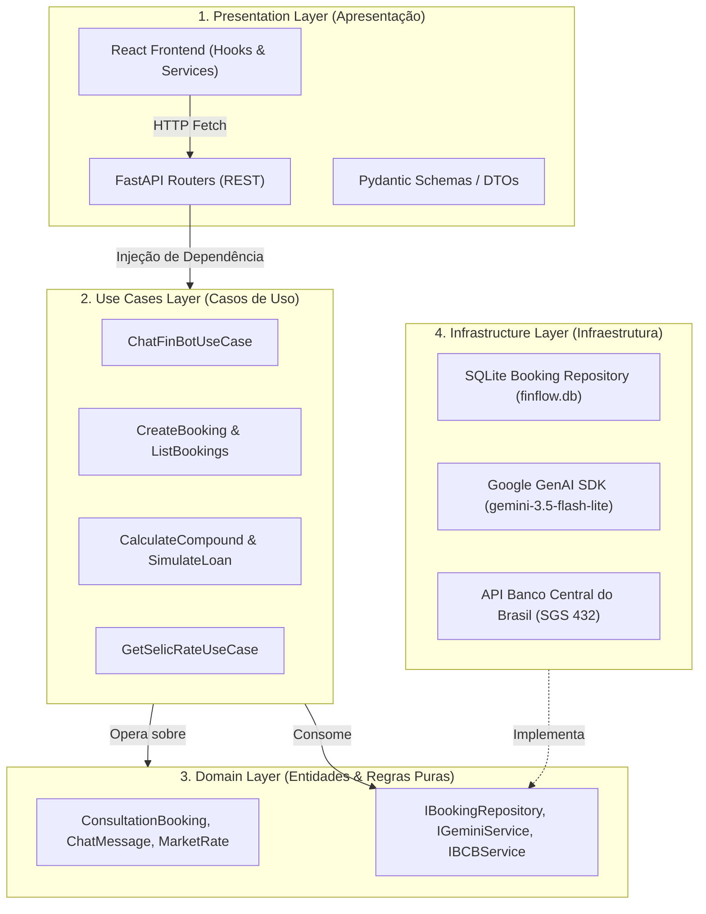

# 💰 FinFlow Capital — Assistente Financeiro Inteligente & Simuladores

<p align="center">
  
  
  
  
  
  
  
</p>

O **FinFlow Capital** é uma plataforma moderna de assessoria financeira e planejamento patrimonial que integra **Inteligência Artificial Generativa (Google Gemini)** com calculadoras matemáticas de alta precisão e agendamento de consultorias.

O projeto foi refatorado e desenhado seguindo rigorosamente os padrões de **Clean Architecture (Arquitetura Limpa)** e princípios **SOLID**, assegurando total desacoplamento entre regras de negócio, infraestrutura de banco de dados, provedores de IA e interfaces visuais.

---

## 🏛️ Arquitetura do Sistema (Clean Architecture & SOLID)

A aplicação é dividida em camadas concêntricas onde as dependências apontam unicamente para dentro (Dependency Inversion Principle):



### Princípios SOLID Aplicados

* **Single Responsibility Principle (SRP):** Cada caso de uso, repositório e hook gerencia uma única responsabilidade.
* **Open/Closed Principle (OCP):** Novos provedores de IA ou bancos de dados podem ser adicionados implementando as interfaces existentes sem modificar os casos de uso.
* **Liskov Substitution Principle (LSP):** As implementações concretas (`SqliteBookingRepository`, `GeminiService`) honram integralmente os contratos de suas interfaces abstratas.
* **Interface Segregation Principle (ISP):** Interfaces coesas e específicas (`IBookingRepository`, `IGeminiService`, `IBCBService`).
* **Dependency Inversion Principle (DIP):** Os controladores e use cases dependem exclusivamente de abstrações, injetadas via FastAPI `Depends()`.

---

## 📂 Estrutura de Diretórios

```bash
chatboot-pixabot-financas/
├── api/                           # Backend Python (Clean Architecture)
│   ├── domain/                    # Entidades e Interfaces puras (Core)
│   │   ├── entities.py
│   │   └── interfaces.py
│   ├── use_cases/                 # Lógica de aplicação e orquestração
│   │   ├── chat_finbot.py         # Conversação IA + Fallback + Action Tags
│   │   ├── manage_booking.py      # Criação e listagem de agendamentos
│   │   ├── calculate_finance.py   # Juros compostos & Tabela Price
│   │   └── get_market_rates.py    # Indicador Selic do Banco Central
│   ├── infrastructure/            # Implementações técnicas e serviços externos
│   │   ├── config.py              # Leitura de variáveis de ambiente
│   │   ├── database/              # SQLite connection & repositório
│   │   └── external/              # SDK do Gemini & API do Banco Central
│   ├── presentation/              # Camada de entrega HTTP (FastAPI)
│   │   ├── dependencies.py        # Container de Injeção de Dependências
│   │   ├── schemas.py             # DTOs de entrada e saída (Pydantic)
│   │   └── routers/               # Controladores REST segregados
│   ├── database.py                # Script utilitário para inicialização do SQLite
│   ├── finflow.db                 # Banco de dados local SQLite
│   ├── main.py                    # Fábrica da aplicação FastAPI
│   ├── requirements.txt           # Dependências do Python
│   ├── .env.example               # Template de variáveis do backend
│   └── .env                       # Variáveis ativas do backend
│
├── src/                           # Frontend React (Arquitetura por Camadas)
│   ├── components/                # Componentes de apresentação desacoplados
│   │   ├── calculators/           # Simuladores de investimento e crédito
│   │   ├── chat/                  # Interface visual do FinBot
│   │   ├── layout/                # Navbar, Footer, SectionHeading
│   │   ├── scheduler/             # Formulário de consultoria
│   │   └── sections/              # Hero, ServicesSection
│   ├── hooks/                     # Custom Hooks (Gerenciamento de Estado)
│   │   ├── useChat.ts
│   │   ├── useCompoundCalculator.ts
│   │   ├── useLoanCalculator.ts
│   │   └── useBooking.ts
│   ├── services/                  # Comunicação HTTP desacoplada
│   │   ├── apiClient.ts           # Cliente base com tratamento de erros
│   │   ├── chatService.ts
│   │   ├── calculatorService.ts
│   │   └── bookingService.ts
│   ├── lib/                       # Utilitários gerais
│   ├── App.tsx
│   └── main.tsx
│
├── .env.example                   # Template de variáveis do frontend
├── .env                           # Variáveis ativas do frontend
├── package.json                   # Dependências do Node.js
└── README.md                      # Documentação do projeto
```

---

## 🚀 Como Executar o Projeto Localmente

### Pré-requisitos
* **Python 3.10+** instalado.
* **Node.js 18+** e **npm** instalados.
* Chave de API do **Google AI Studio** (gratuita em [aistudio.google.com](https://aistudio.google.com/)).

---

### 1. Configurando o Backend (Python / FastAPI)

1. Entre na pasta `api` e crie um ambiente virtual:
   ```bash
   cd api
   python -m venv .venv
   ```

2. Ative o ambiente virtual:
   * **No Windows (PowerShell):**
     ```powershell
     .\.venv\Scripts\Activate.ps1
     ```
   * **No Linux/Mac:**
     ```bash
     source .venv/bin/activate
     ```

3. Instale as dependências:
   ```bash
   pip install -r requirements.txt
   ```

4. Configure as variáveis de ambiente:
   * Crie o arquivo `api/.env` baseado no `api/.env.example`:
     ```env
     GEMINI_API_KEY="SUA_CHAVE_AQUI"
     GEMINI_PRIMARY_MODEL="gemini-3.5-flash-lite"
     GEMINI_FALLBACK_MODEL="gemini-3.8-flash"
     ```

5. Inicialize o servidor da API:
   ```bash
   uvicorn main:app --reload --port 8000
   ```
   * 🟢 A API iniciará em: `http://localhost:8000`
   * 📖 Documentação interativa (Swagger UI): `http://localhost:8000/docs`
   * 📖 Documentação alternativa (ReDoc): `http://localhost:8000/redoc`

---

### 2. Configurando o Frontend (React / TypeScript / Vite)

1. Abra um novo terminal na raiz do projeto (`chatboot-pixabot-financas`):
2. Instale os pacotes npm:
   ```bash
   npm install
   ```

3. Configure o arquivo `.env` na raiz:
   * Crie o arquivo `.env` baseado no `.env.example`:
     ```env
     VITE_API_URL=http://localhost:8000
     ```

4. Execute o servidor de desenvolvimento:
   ```bash
   npm run dev
   ```
   * 🟢 A aplicação estará disponível em: `http://localhost:5173`

---

## 📡 Tabela de Endpoints da API

| Método | Rota | Descrição | Exemplo de Payload / Resposta |
| :--- | :--- | :--- | :--- |
| `GET` | `/api/health` | Status de saúde da aplicação e modelos. | `{"status": "healthy", "gemini_configured": true}` |
| `POST` | `/api/chat` | Conversa com o FinBot (Gemini AI + Fallback). | **Body:** `{"messages": [{"role": "user", "content": "Como investir?"}]}` |
| `POST` | `/api/agendar` | Salva solicitação de consultoria no SQLite. | **Body:** `{"full_name": "Ana Silva", "email": "ana@email.com", "phone": "11999999999", "objective": "Planejar aposentadoria", "preferred_date": "2026-12-10", "preferred_period": "morning"}` |
| `GET` | `/api/agendamentos` | Lista os agendamentos registrados no banco. | **Response:** `{"bookings": [...]}` |
| `POST` | `/api/calculator/compound-interest` | Projeta crescimento patrimonial com juros compostos. | **Body:** `{"initial": 10000, "monthly": 500, "rate_annual": 10.5, "years": 10}` |
| `POST` | `/api/calculator/loan-simulation` | Simula custo total e amortização de empréstimos. | **Body:** `{"amount": 25000, "rate_annual": 18, "months": 36}` |
| `GET` | `/api/market/selic` | Consulta a taxa Selic oficial vigente no Banco Central. | **Response:** `{"indicator": "Taxa Selic Meta (% a.a.)", "selic_annual_rate": 13.75, "reference_date": "...", "is_fallback": false}` |

---

## 💡 O que Eu Aprendi com o Projeto

1. **Separação Rígida entre Regras de Negócio e Frameworks:**
   Aplicar Clean Architecture na prática demonstrou como manter o domínio isolado de dependências voláteis como FastAPI ou SQLite torna o sistema infinitamente mais testável e extensível.
2. **Resiliência em Sistemas Baseados em IA (Graceful Degradation):**
   Modelos de IA sofrem descontinuações de versão (ex: depreciação do `gemini-2.5-flash`), limites de cota e instabilidade de rede. Desenvolver um fluxo com **múltiplos modelos em cascata** (`gemini-3.5-flash-lite` -> `gemini-3.8-flash`) e **contingência determinística por regras locais** garantiu que o usuário final nunca receba uma tela em branco ou erro 500.
3. **Consumo de APIs Governamentais Abertas:**
   A integração direta com o Sistema Gerenciador de Séries Temporais (SGS) do Banco Central do Brasil enriqueceu os simuladores com dados financeiros em tempo real, mantendo um mecanismo de cache/fallback para tolerância a falhas.
4. **Desacoplamento no Frontend com Custom Hooks:**
   A migração de lógicas de estado e chamadas `fetch` de dentro dos componentes JSX para `services/` e `hooks/` gerou componentes limpos, focados exclusivamente na experiência visual (Single Responsibility).

---

## 🔮 Futuras Melhorias

- [ ] **Autenticação & Autorização:** Implementação de JWT (JSON Web Tokens) e OAuth2 para área administrativa restrita onde consultores possam aprovar agendamentos.
- [ ] **Testes Automatizados:** Cobertura de testes unitários com `pytest` (para use cases e domínio) e testes de integração de componentes React com `Vitest` + `React Testing Library`.
- [ ] **Persistência PostgreSQL via Docker:** Suporte opcional a PostgreSQL em produção via SQLAlchemy ou SQLModel, mantendo o SQLite para desenvolvimento local leve.
- [ ] **Histórico Persistente de Chat por Sessão:** Armazenamento das conversas do FinBot em banco com identificador de sessão (`session_id`) para retomar diálogos.
- [ ] **Exportação de Relatórios:** Download em PDF/Excel com o gráfico e a tabela de evolução patrimonial calculada pelo usuário.

---

<p align="center">
  Desenvolvido com foco em excelência arquitetural, manutenibilidade e experiência do usuário.
</p>

